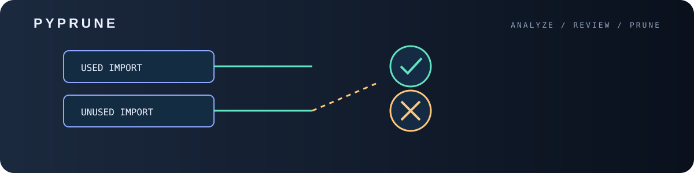

<p align="center">

<p align="center"></p>
  
</p>

<h1 align="center">pyprune</h1>

<p align="center">
  Find and remove unused imports in your Python projects.<br>
  <b>One file. Zero dependencies. Dry-run by default.</b>
</p>

---

## Quick start

No install needed. Download the single file and run it:

```bash
curl -O https://raw.githubusercontent.com/ERROR404DTIR/pyprune/main/pyprune.py
python pyprune.py
```

Requires Python 3.9+ (standard library only).

## Usage

```bash
python pyprune.py                 # report unused imports under the current folder
python pyprune.py src/ app.py     # scan folders and files
python pyprune.py src/ --fix      # remove unused imports in place
python pyprune.py --defs          # also list top-level functions/classes nobody references
```

| Option | Meaning |
|---|---|
| `--fix` | Remove unused imports in place |
| `--defs` | List top-level functions/classes never referenced anywhere in the scanned files |
| `--init` | Include `__init__.py` files (skipped by default because they re-export names) |

## How it stays safe

- **Dry-run first.** Nothing is changed unless you pass `--fix`.
- **Syntax check.** A fixed file is re-parsed; if it wouldn't be valid Python, it is left untouched.
- **Conservative fixes.** Only single-line imports are rewritten; multi-line imports are reported but left for you.
- **Smart skips.** Ignores `from __future__` imports, `# noqa` lines, `import x as x` re-exports, `try/except ImportError` guards and names used in `__all__` or string annotations.

Exit code is `1` when unused imports are found (without `--fix`), which makes it handy in CI.

## Tip

Commit your work before running `--fix` so you can review the diff with `git diff`.